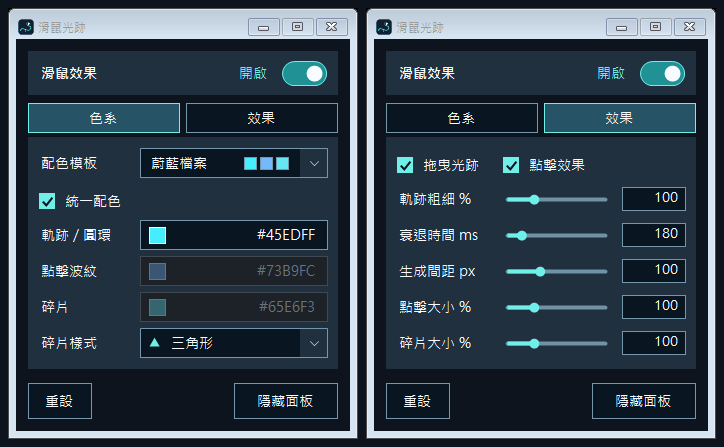
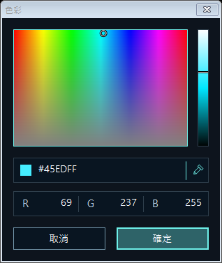
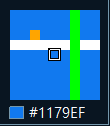
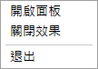
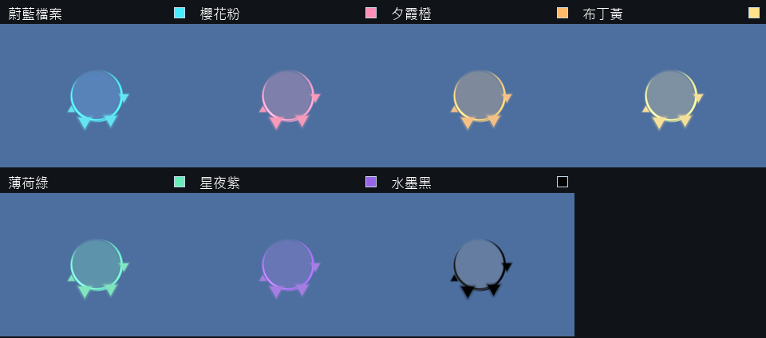
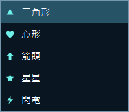
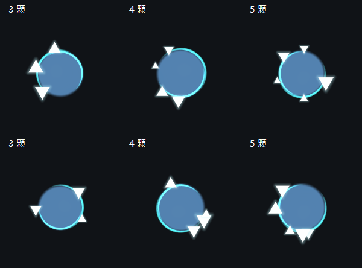

# CursorEffects

**[下載 EXE（122.5KB）](https://github.com/g114056175/my_tools/releases/download/cursor-effects/CursorEffects.exe)**

> **防毒偵測提醒：** 部分建置可能被 Microsoft Defender 判為木馬並阻擋執行；相同原始碼重編譯後，偵測結果也可能不同。目前尚未確認是否為誤報，重新編譯後可執行不代表問題已解決。詳見[防毒偵測說明](#user-content-防毒偵測)。

參考《蔚藍檔案》遊戲內鼠標粒子效果嘗試模擬。Windows桌面裝飾：拖曳顯示光跡，點擊產生波紋與碎片。

單檔EXE，支援Windows 10（1703以上）／11 x64，需.NET Framework 4.8。

效果以60 FPS繪製，閒置時停止渲染。測試機播放預設效果約使用0.07% CPU、92 MiB記憶體，實際用量依電腦與設定而異。

## 效果


## 面板







- 「色系」選模板或自訂顏色；統一配色時，波紋與碎片會依主色調整。關閉後可分別選色。
- 點選色碼開啟選色視窗，左側調色、右側亮度，也可輸入HEX／RGB或使用滴管。確定才套用，取消保留原色；滴管啟用時面板保持可見，游標旁顯示局部放大鏡與色碼，按Esc、右鍵或再點滴管取消。
- 「效果」調整軌跡粗細、衰退時間、碎片生成間距、點擊大小與碎片大小。
- 右上開關控制整體效果；「隱藏面板」藏到托盤，雙擊托盤叫回。托盤右鍵選單提供「開啟面板」「開啟／關閉效果」「退出」，使用簡單白底黑字。X退出，設定自動保存。



## 配色



蔚藍檔案、櫻花粉、夕霞橙、布丁黃、薄荷綠、星夜紫、水墨黑，也可使用自訂色。

## 碎片



三角形正倒隨機、箭頭四向隨機，心形、星星與閃電固定正向。拖曳與點擊共用樣式及大小；碎片會長大、閃爍再縮小。單次點擊的碎片角度獨立隨機，保留同側群聚與部分重疊；近乎同位時才做有限候選比較。



<details>
<summary><strong>與官方效果對比（展開）</strong></summary>

左側為《蔚藍檔案》官方效果，右側為本工具的模擬。官方沿用既有錄影，本機效果合成至相同背景；顏色、圓弧消散與隨機碎片仍有差異。

### 單次點擊，8倍慢速


### 快速連點，4倍慢速


依官方錄影中可見的點擊幀同步重播，間隔約150–333ms；並非固定50ms的高速連點。

### 逐幀關鍵畫面


0ms為官方錄影首個可見效果幀，不代表滑鼠輸入時間。

</details>

<details>

<summary><strong>建置、驗證與技術細節（點此展開）</strong></summary>

### 技術

C#／WinForms 控制面板，C++／Direct2D + DirectComposition 繪製。僅更新效果附近的小區域，閒置時停止渲染；原生模組內嵌於 EXE，GPU 不可用時使用 WARP 軟體繪圖。

選色視窗由WinForms及GDI+繪製HSL調色區：左側為色相／飽和度，右側為亮度，與HEX／RGB雙向同步。滴管只在選取期間以`WH_MOUSE_LL`接收選色點擊，透過`GetDC`／`GetPixel`讀取該處的即時RGB，隨即釋放監聽；選色面板保持可見，游標旁以110×126像素的提示窗顯示附近9×9像素的即時放大圖、色塊與HEX；提示窗不取得焦點，並穿透點擊。不擷取整張桌面，不建立全螢幕覆蓋視窗。結果先回到選色視窗，按確定才套用。編輯顏色時暫停特效，主面板與選單使用`WindowFromPoint`判斷滑鼠實際命中的視窗，只阻止在工具UI上的操作；面板被其他視窗覆蓋時，該位置仍可正常產生特效，不使用固定區域裁切。標題列採一般Windows原生視窗樣式。主要文字10pt，面板334×392，選色視窗312×348。

以計時器讀取左鍵狀態：閒置時每50ms檢查一次，偵測到按住後改為每10ms追蹤點擊與拖曳；放開後維持高頻檢查250ms，再回到閒置。狀態輪詢可能漏掉短於當前檢查間隔的點擊。點擊動畫由獨立的按需影格時鐘推進，最多每秒60幀，不依賴輸入輪詢。效果畫在不取得焦點、可穿透點擊的透明置頂視窗中：Direct2D繪圖，Direct3D 11提供圖形裝置，DirectComposition交由桌面視窗管理員（DWM）合成。

視覺上是「系統游標 → 光效 → 一般視窗」。光效依靠視窗置頂順序，並非取得Windows保留的游標專用層；其他置頂視窗、獨占全螢幕或安全桌面不保證相同結果。

光跡連接滑鼠取樣點，轉折以二次曲線補間，使用 MAX 混合避免重疊處變亮。碎片按累積位移生成；點擊圓底與外環共用半徑，外環疊在圓底邊緣。原始閃光於出生時最亮，以固定出生半徑自然衰退至100ms；水波本身不混白，約245ms淡出。連點白色來自各次初始閃光的殘留疊加；相鄰雙弧重疊增亮並逆時針旋轉，約600ms逐段消散。點擊和五種碎片具有局部光暈，遮罩只建立一次，不使用全畫面柔光。點擊碎片角度獨立隨機；與同批已有碎片相差不到約12°時，最多比較三個候選，選較不擁擠的一個。12°是觸發修正的門檻，不是保證的最小角距；同側群聚、少量近距離與跨批次重疊仍可能發生。只有出生時做有限比較，沒有每幀碰撞檢查或無限重試。這是本工具的分布改善，既有官方錄影不足以確認相同規則。碎片先長大再縮小，同時隨波紋擴張並小幅向外漂移；亮白停留與轉色時間各自隨機。

水波使用快取的內外顏色權重，形成柔和色差；出生外圍有帶方向變化的藍色光暈，隨模板變色。兩段外環略微錯開半徑並重疊，弧段末端漸細、漸淡；遮罩僅裁透明度，避免 RGB 被重複乘上透明度造成灰黑弧端。各形狀的光暈只留在外側。碎片轉色後的透明度會三次降低、回升，最後淡出，不反覆回到白色。

正式編譯排除測試專用介面與日誌；UI區域檢查使用固定四區域的迴圈，避免建立iterator與LINQ查詢；Windows繪圖功能由C++模組提供，C#只保留實際使用的原生介面。

設定及原生 DLL 快取位於 `%LOCALAPPDATA%\BlueArchiveCursor.Native`。設定自動儲存，再次執行會叫回面板。外觀為桌面環境的近似重現；不附帶遊戲解包檔案。

Windows 版本下限依據所用的 [DPI API](https://learn.microsoft.com/en-us/windows/win32/api/winuser/nf-winuser-setprocessdpiawarenesscontext)。Windows 11 尚未實機驗證。

### 建置

在 Windows PowerShell 5.1 進入專案根目錄。需系統 .NET Framework C# compiler 與固定版本的 [LLVM-MinGW 20260616／Clang 22.1.8，x64 UCRT](https://github.com/mstorsjo/llvm-mingw/releases/tag/20260616)：

```powershell
# PATH 已有同版 LLVM-MinGW 時，可略過工具鏈下載
powershell -NoProfile -ExecutionPolicy Bypass -File tools/setup-toolchain.ps1
powershell -NoProfile -ExecutionPolicy Bypass -File build.ps1
powershell -NoProfile -ExecutionPolicy Bypass -File release.ps1
```

工具鏈下載約 179 MiB，僅供建置；版本、網址與 SHA-256 在 `toolchain.json`。可用 `build.ps1 -Compiler "完整路徑\clang++.exe"` 指定同版編譯器。無須 Visual Studio、Node 或 Python。

- `dist/CursorEffects.exe`：單檔 EXE。
- `dist/`：程式、說明與效果圖。
- `.build/build-info.json`：編譯器版本及來源／產物雜湊。

可重建功能相同的程式，不保證 EXE 位元組完全一致。下載的工具鏈、產物與測試結果已列入 `.gitignore`。

### 防毒偵測

目前建置流程不保證每次輸出的位元組完全一致；編譯時間戳與模組識別碼（MVID）等資訊可使相同原始碼產生不同 SHA256。可參考微軟的 [C# 決定性編譯說明](https://learn.microsoft.com/en-us/dotnet/csharp/language-reference/compiler-options/code-generation#deterministic)。

Microsoft Defender 結合本機防護、雲端分析與機器學習判定，結果可能隨檔案或掃描時點改變。曾觀察到相同原始碼的建置被偵測為 `Trojan:Script/Sabsik.TE.A!ml`，而另一次建置通過本機掃描與啟動檢查；目前尚未釐清具體觸發原因，也未取得微軟的誤報判定。一次掃描通過不保證其他環境或日後掃描不會攔截。[微軟雲端防護說明](https://learn.microsoft.com/en-us/defender-endpoint/cloud-protection-microsoft-defender-antivirus)

若遇到攔截，請保留偵測名稱與檔案 SHA256，透過[微軟官方檔案分析平台](https://www.microsoft.com/en-us/wdsi/filesubmission)以軟體開發者身分提交確認。[開發者偵測申訴說明](https://learn.microsoft.com/en-us/defender-xdr/developer-faq)

### 驗證

```powershell
powershell -NoProfile -ExecutionPolicy Bypass -File tests/verify.ps1
powershell -NoProfile -ExecutionPolicy Bypass -File tests/release-smoke.ps1
powershell -NoProfile -ExecutionPolicy Bypass -File tests/performance.ps1
```

圖形驗證需要互動桌面與硬體 GPU；單檔啟動驗證前先退出正在執行的程式。結果寫入 `test-results/`；效能測試只統計本程式，使用內部測試座標，不操作系統滑鼠。


### 大小與效能


**EXE：122.5 KiB（125,440 bytes）**；首次執行另釋出約 **25 KiB** 原生 DLL，使用者只需下載 EXE。

測試電腦：**i5-12600K、RTX 4060、Windows 10 22H2**，桌面範圍 3840×1080。

| 狀態 | CPU | 記憶體（工作集） |
| --- | ---: | ---: |
| 啟動後閒置 | 0.016% | 約 79 MiB |
| 持續播放預設效果 | 0.065% | 約 92 MiB |
| 間距 8 px | 0.065% | 約 92 MiB |
| 間距 8 px、大小 300%、衰退 1000 ms | 0.698% | 約 97 MiB |
| 每 16 ms 跨桌面跳動，間距 8 px | 0.081% | 約 101 MiB |

效果固定 60 FPS，結束後停止繪製。量測中 GPU 引擎最高讀值約 6%；壓力測試後閒置工作集可能維持約 102 MiB。

以上為 2026-10-12 隱藏面板、每階段 6 秒的短時量測；CPU 按 16 邏輯執行緒折算，低讀值受計時精度影響，未包含桌面合成器（DWM）。預設效果每幀 CPU 送出平均約 0.59 ms，幀間隔第 95 百分位約 17.3 ms，並非滑鼠到顯示的端到端延遲。不同電腦與測量時段會有差異。


編譯採用`-Os -flto`；碎片共用快取幾何與旋轉矩陣，繪圖時減少重複的狀態設定。

### 未來打算

- 增加點擊樣式，與碎片樣式分開。
- 探索透明PNG／符號匯入，限制解碼尺寸並快取GPU資產。
- 建立多次效能量測與端到端延遲驗證，再評估減少狀態切換或合批繪製。

以上尚未實作；目前維持少量主要調整項。

</details>
