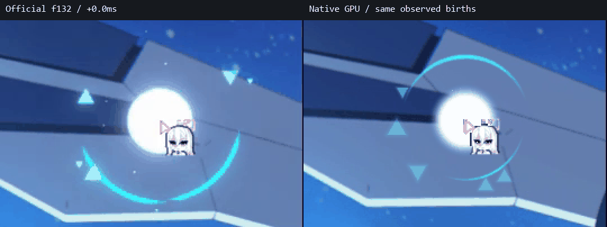
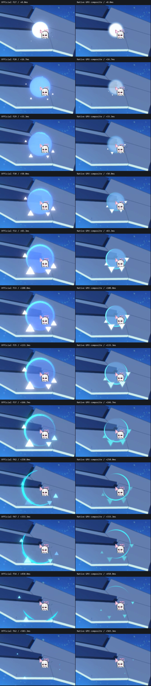
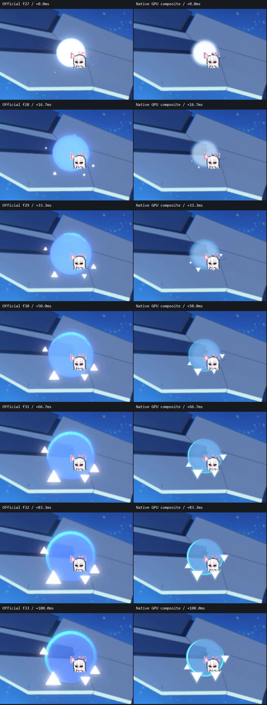

# 官方與CursorEffects對比

左側為《蔚藍檔案》官方錄影，右側為正式版的實際GPU畫面合成至參考背景。顏色、圓弧消散與隨機碎片仍有差異；0ms是官方首個可見效果幀，不是輸入時間。

## 單次點擊，8倍慢速

官方使用f27–62，共36幀；兩側共用時間軸，碎片位置及圓弧初始方向未配對。

## 快速連點，4倍慢速

官方使用f132–219，依可見點擊幀同步重播，包含官方影片中的前次點擊殘留。間隔約150–333ms，並非固定50ms的高速連點；可見幀不等同OS輸入時間。

[連點關鍵幀](analysis/02_continuous/04_official-native-rapid-keyframes.png) · [時間序列與素材來源](analysis/02_continuous/official-existing-rapid.json)

## 逐幀關鍵畫面

[全部36幀](analysis/01_click/00_README.md) · [16／33／133／166／333／450ms集中檢視](analysis/01_click/07_early-and-dissolve.png) · [50／83／100ms集中檢視](analysis/01_click/08_50-83-100ms.png)

官方HDR、影片壓縮與背景混色會影響外觀，正式版在桌面SDR環境作近似模擬；對照不是端到端延遲量測。

<strong>正式版實作觀察與驗證（展開）</strong>

波紋基準半徑60px，使用透明混合；連點白光來自各次出生閃光的殘留疊加。外環由重疊圓弧逆時針旋轉並呈月牙消散。碎片先長大、轉色、三次明暗回升，再縮小淡出。

[連點、拖曳與碎片觀察](analysis/00_README.md) · [模板色值與166ms畫面](analysis/05_palettes/00_README.md) · [五種碎片樣式](analysis/06_shapes/00_README.md)

正式版通過31項功能與15組GPU檢查、獨立啟動與Defender掃描。預設每幀CPU送出平均約0.59ms、幀間隔p95約17.3ms，僅為短時取樣；不代表輸入至顯示延遲。

[完整驗證](analysis/04_verification/verification.json) · [正式版建置紀錄](analysis/04_verification/build-info.json) · [正式版效能量測](analysis/04_verification/performance.json)

