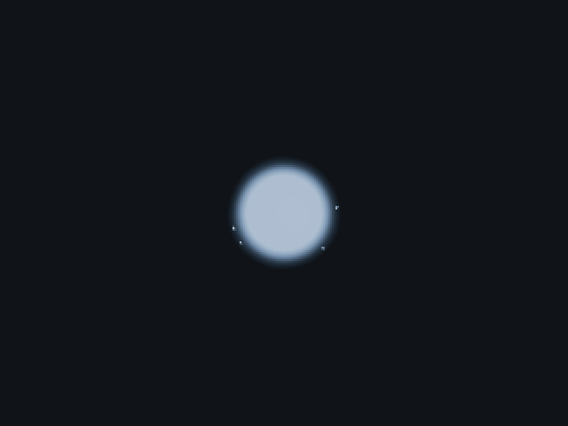
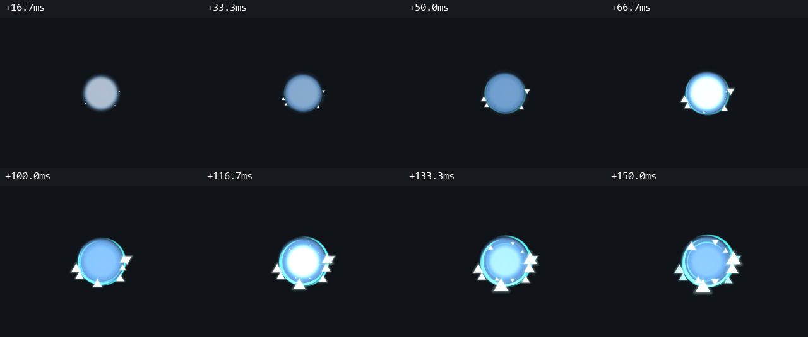
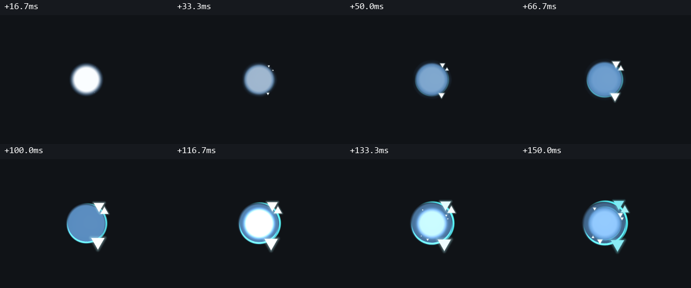
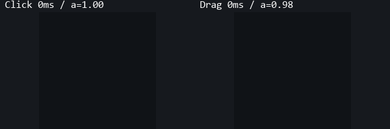
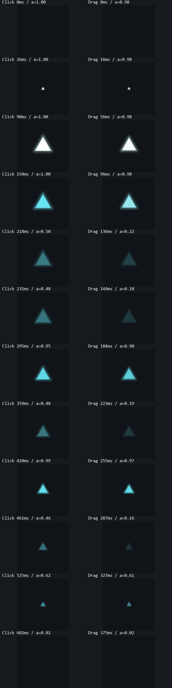
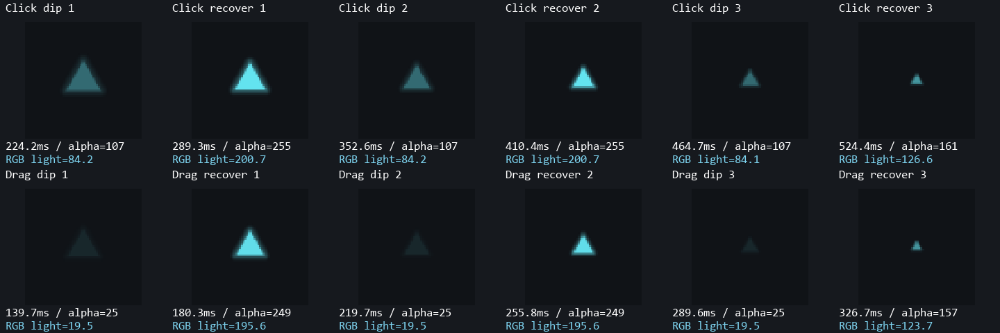

# 分析資料索引

| 資料夾 | 內容 |
| --- | --- |
| `01_click` | 36 個連續時間點、六張連續幀圖、每幀對照，以及黑底的原生 GPU 預覽 |
| `02_continuous` | 每50／100ms連點、拖曳預覽與各自關鍵幀 |
| `03_fragments` | 官方單顆碎片局部觀察；目前版本的放大、轉色、明暗變化及縮小 |
| `04_verification` | 正式 EXE 雜湊、來源核對、GPU／功能／效能驗證與預覽來源 |
| `05_palettes` | 七種模板、深淺背景預覽與實際三項色值 |
| `06_shapes` | 五種碎片的4倍慢速GPU預覽、方向及關鍵幀 |
| `source` | 官方影片抽出的原始 PNG；不混入正式版或合成圖 |
| `scripts` | 重新輸出目前比對的腳本 |

## 高速連點

每50ms點擊一次，每次發生在顯示幀前12ms。以下放慢4倍；這是本機GPU捕捉，沒有同條件的官方連點錄影。

正式版水波採一般透明混合，不混白；初始閃光以固定出生半徑自然衰退並疊加。50／100ms間距測試點擊後6／12／16.7ms，中心RGB皆為255／255／255；單次點擊的原始RGBA取樣見[徑向亮峰、環繞與連點取樣](04_verification/layering.json)，其中RGB為預乘值，不是合成到背景後的顏色。

[初始閃光獨立GPU逐幀](01_click/09_birth-flash.png) · [50／83／100ms官方與正式版集中檢視](01_click/08_50-83-100ms.png) · [七種模板](05_palettes/00_README.md)

以60FPS更新、每100ms點擊一次，以下放慢4倍。這是本機測試座標的 GPU 捕捉，沒有相對應的官方連點錄影。

## 拖曳

生成間距100px，以下放慢4倍；本機測試座標的 GPU 捕捉。

## 單顆碎片

左右各固定一顆已生成的碎片，停止漂移與新生，放大3倍。兩側使用相同生命比例，實際毫秒不同，標在各自上方；這不是兩者相同時間的對照。

`a` 是繪圖命令透明度。正式版光暈只繪在碎片外側，避免在本體下方疊加、填亮暗谷。官方有效資料有三次 alpha 暗／亮變化，RGB 從白轉藍，不反覆回白。本機另以42%點擊／10%拖曳基底透明度校準 SDR，再加尾段淡出。

## 實際GPU閃爍驗證

以下每一列固定同一顆碎片，停止漂移與新生，沒有水波或外環重疊。依序顯示三次暗谷及回亮，圖片放大以便觀察；點擊與拖曳的生命週期不同，毫秒各自標示。

點擊碎片三次回亮的中心RGB加權亮度約為暗谷的 **2.38／2.38／1.51倍**；最後一輪同時進入尾段淡出，因此回升幅度較小。這是正式版自身的GPU像素量測，不是官方影片的亮度比值。[逐點數據](04_verification/motion.json) 記錄於 `flickerPixels`。

[官方局部觀察](03_fragments/official/capture_1-f27-f62-triangle-summary.zh-TW.md) · [回到主對照](../00_README.md)

## 官方／正式版連點同步對照

[4倍慢速同步GIF](02_continuous/04_official-native-rapid-4x.gif) · [關鍵幀](02_continuous/04_official-native-rapid-keyframes.png) · [點擊時間與限制](02_continuous/official-existing-rapid.json)

官方既有f132–219，同位置連點間隔約150–333ms。正式版依可見幀重播，保留官方影片中的前次點擊殘留；不是50ms官方新錄影。
