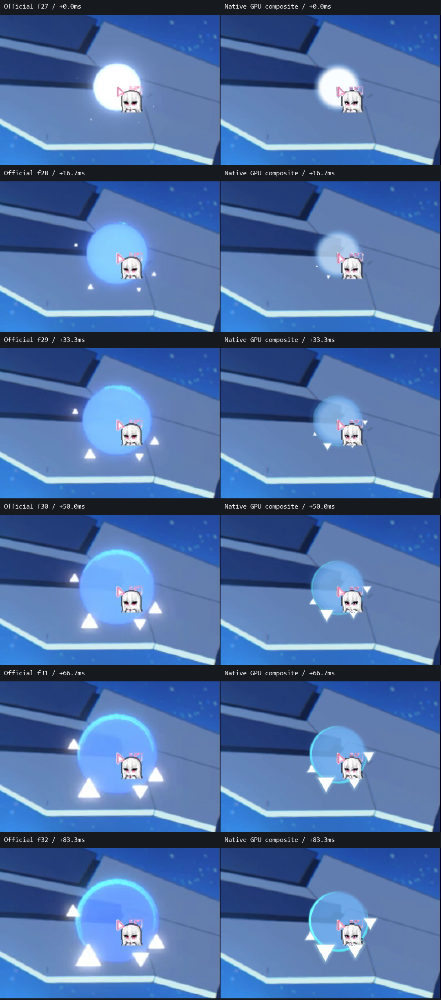
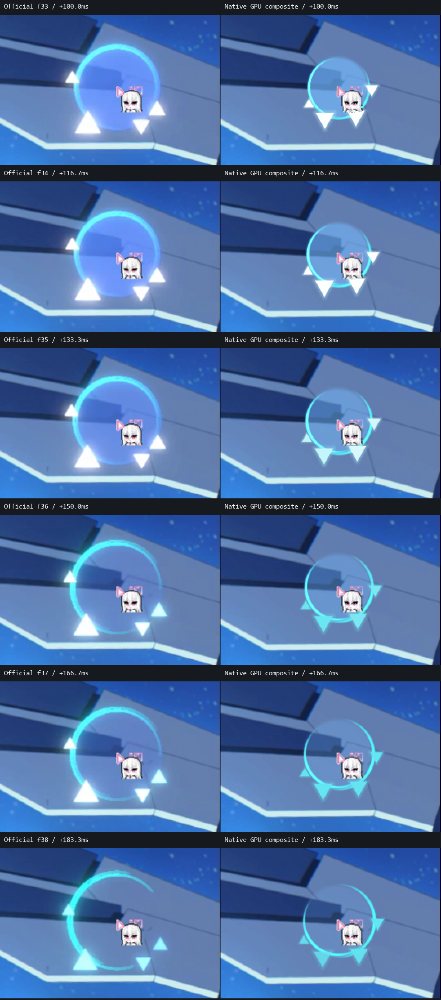
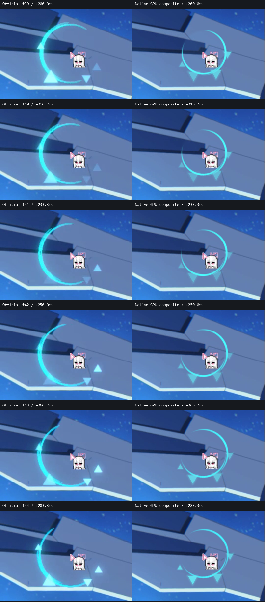
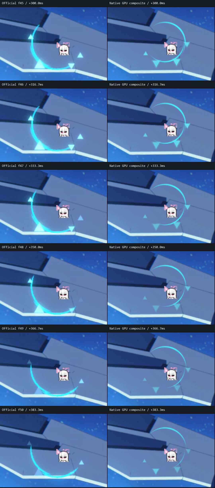
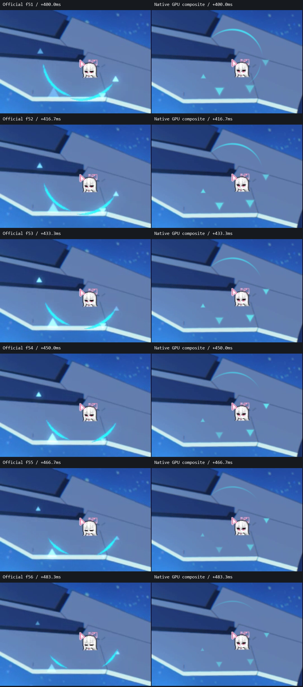
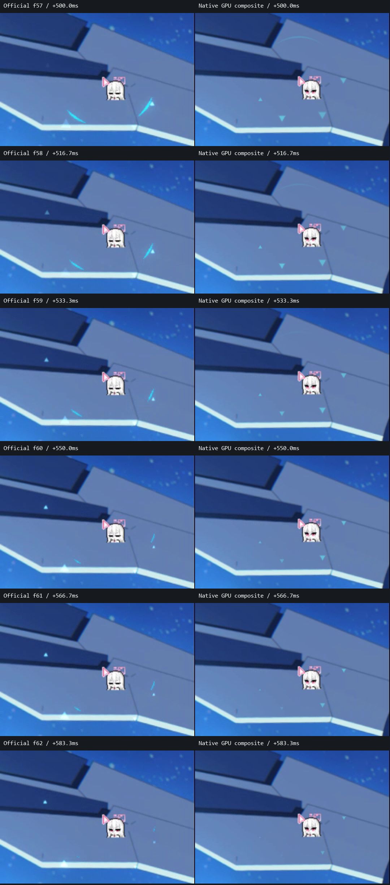

# 點擊36幀：按時間排序

左為官方錄影，右為目前編譯版的 GPU 畫面合成。以官方 f27 作為0ms，每幀間距約16.7ms，直到 f62／583.3ms。共有36個時間點，以下分成六組，每組六幀。

單張對照位於 `frames/`，以 `001_000.0ms.png` 到 `036_583.3ms.png` 排序。這些毫秒是相對於第一個可見畫面，不是官方輸入延遲量測。

正式版100%採60px波紋基準，與官方錄影的尺寸可能不同。

## 01：0–83ms

正式版從出生白光逐漸轉為藍色波紋；比較出生光暈、藍色水波與外環逐漸形成的層次。

## 02：100–183ms

比較外環的亮度層次與碎片亮峰。碎片位置及大小為隨機，觀察整體亮度和成長節奏即可。

## 03：200–283ms

圓底已接近消失，外環和碎片主導畫面。兩側保留的長亮弧與碎片明暗程度不同。

## 04：300–383ms

兩側仍有較長的亮弧。正式版弧段邊端逐漸收窄並淡出；方向是隨機的，碎片仍可能落在不同明暗谷。

## 05：400–483ms

正式版亮弧在這段仍可辨識；觀察亮度淡出以及轉色後碎片的縮小。原生弧線比官方影片更乾淨，並非完全相同的材質。

## 06：500–583ms

接近單次點擊結束。官方影片在下一幀又開始另一個點擊，因此這裡截到f62，避免混入下一次事件。

## 不混合背景的本機預覽

[藍色原速](native-on-dark/blue-1x.gif) · [藍色慢速](native-on-dark/blue-8x.gif) · [粉色原速](native-on-dark/pink-1x.gif) · [粉色慢速](native-on-dark/pink-8x.gif)

[回到主對照](../../00_README.md)
