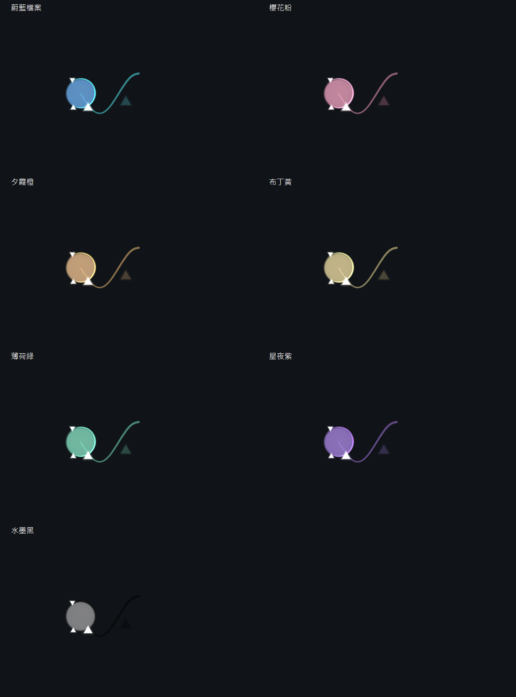
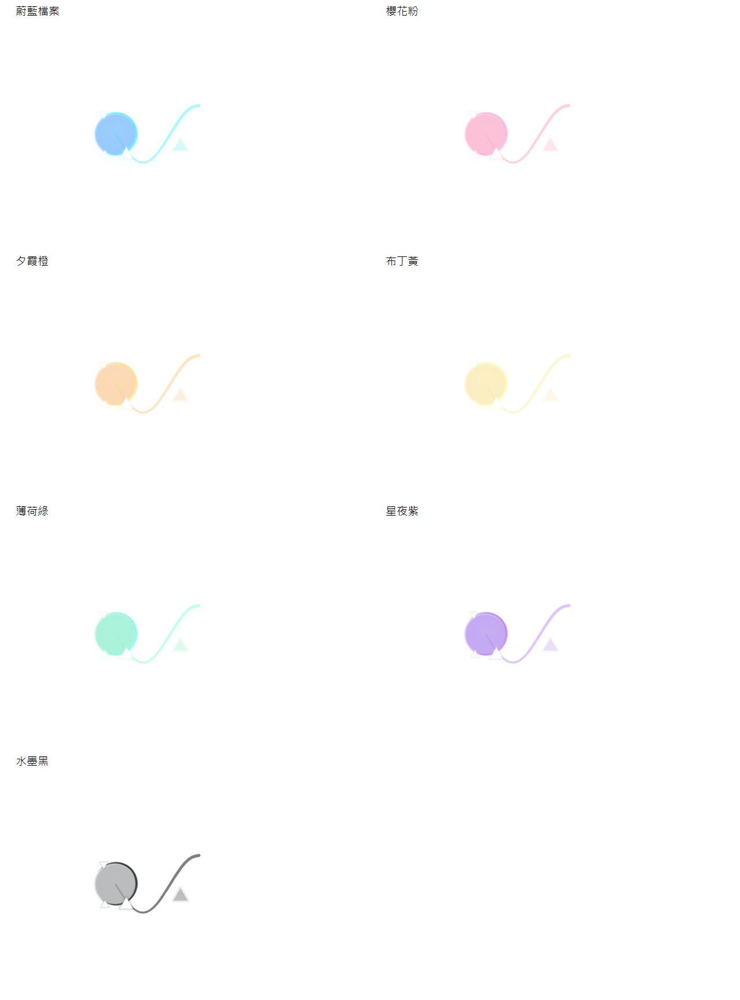
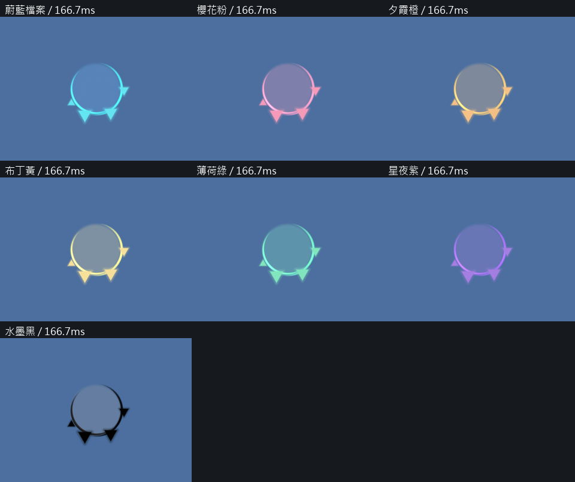

# 七種模板

蔚藍檔案、櫻花粉、夕霞橙、布丁黃、薄荷綠、星夜紫、水墨黑。每個模板展示軌跡與點擊的實際GPU輸出；深淺背景使用相同設定。

水墨黑以純黑軌跡、純黑轉色後碎片搭配淡灰色波紋。其他顏色可使用自訂色。

[實際主色、波紋與碎片色值](palette-colors.json) · [回到對照](../../comparison.md)

## 166ms的波紋與碎片

統一配色下，波紋明度比轉色後碎片高，波紋不透明度倍率為0.80；夕霞橙主色為偏黃的`#FFB96A`。碎片100ms附近仍保持亮白，166ms多數已轉成較深的模板色。出生白光為獨立自然衰退的閃光，不是波紋內新增白色區。

[實際GPU亮度取樣](../04_verification/palette-hierarchy.json)。此量測去除alpha影響，用於檢查色值層次；背景合成與閃爍仍會影響肉眼亮度。關閉統一配色後，使用者指定的波紋及碎片色保持原值。

波紋色由主色提高明度並調整飽和度，不透明度倍率為0.80。碎片色較波紋深；水墨黑轉色後保留RGB0，出生時仍有白光。
