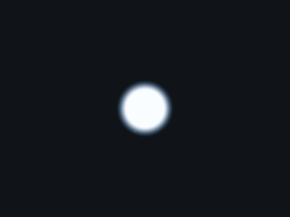
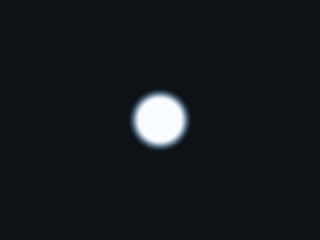
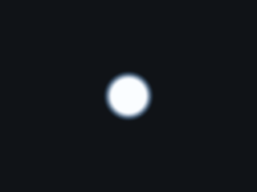
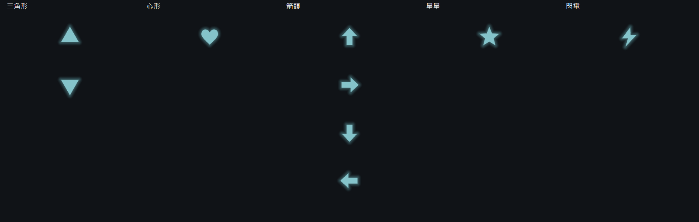
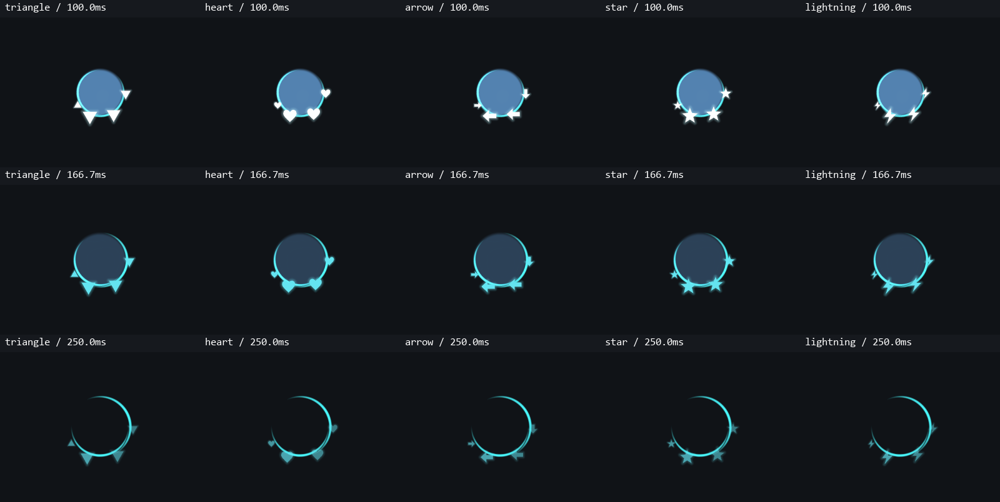

# 五種碎片樣式

實際GPU捕捉，4倍慢速。五種樣式使用相同點擊座標、隨機種子及生命週期；只有幾何和方向規則不同。碎片大小基準為2.2。

## 三角形：正倒隨機

## 心形：固定正向

## 箭頭：四個方向隨機

## 星星：固定正向

## 閃電：固定正向

## 方向與關鍵幀

切換樣式保留現有粒子，不重新生成。五種形狀都有獨立快取的外側光暈，沿用長大、轉色、三次明暗回升及縮小；三角形以外沒有官方對照。下拉選單以快取的向量圖示加文字呈現。

[擴充說明](../../../fragment-shapes.md) · [回到對照](../../comparison.md)
