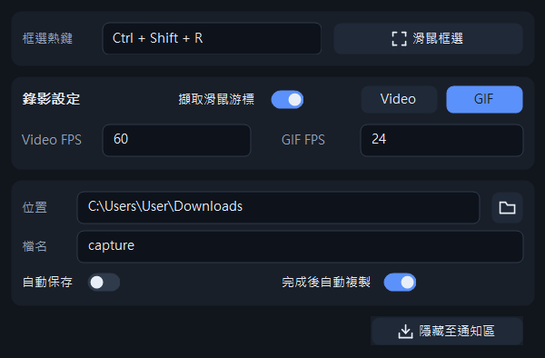
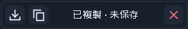
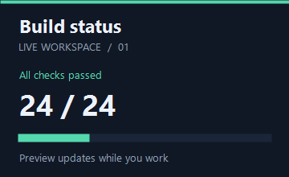

# RegionRecorder

**[下載 RegionRecorder.exe](https://github.com/g114056175/my_tools/releases/download/region_recorder-v1.0.0/RegionRecorder.exe?sha=32b381b2bedd)**

輕量的範圍錄製工具，適合記錄桌面操作、製作教學片段與 GIF 動圖，支援跨螢幕、滑鼠游標及暫停錄製。

適用 Windows 10 2004 以上／Windows 11，x64。單一 EXE 即可執行，不需安裝；Windows N 版本需先安裝 Media Feature Pack。

錄製桌面當下可見的內容，不會產生系統黃色擷取框；WGC 備用下載見文末。

## 使用說明

1. 設定 GIF／Video、FPS、保存位置與自動保存選項。
2. 按「滑鼠框選」或 `Alt + Shift + R` 選取範圍，再按 **● 錄製**。
3. 錄製中可停止、暫停／繼續或重新框選；紅色 **×** 會先暫停，再詢問是否捨棄。
4. 結束後保存，或取消保存後複製暫存錄影；關閉結果會清除未保存的檔案。

預設 GIF 24 FPS、Video 60 FPS；保存位置為目前帳號的下載資料夾。選區框線與工具列不會出現在成品中。

| 框選後 | 錄製中 | 未保存結果 |
| --- | --- | --- |
|  |  |  |

## 錄製限制

| 格式 | 容量上限 | 時間上限 |
| --- | --- | --- |
| GIF | 300 MB | 1 分鐘 |
| MP4 | 4 GB | 30 分鐘 |

**容量或時間任一先達上限，就會強制停止錄製。**

GIF 最多 256 色，適合簡單的操作示範；照片、漸層或變動較大的畫面建議使用 MP4（H.264）。

**目前只錄畫面，不錄系統聲音或麥克風。**

## GIF 示範

WGC 備用版本

[下載 WGC 舊版](https://github.com/g114056175/my_tools/releases/download/region_recorder-v1.0.0/region_recorder_wgc.exe)

部分 Windows 環境會顯示系統黃色擷取框；此備用程式同樣只錄製桌面可見內容，不會穿透遮擋。

舊版使用 `Ctrl + Shift + R`，兩版設定各自保存。

