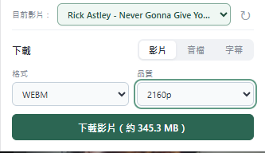
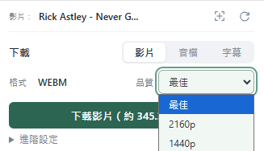

# VideoPocket - 網頁媒體下載與擷取 

**[下載 ZIP（約 2.2 MB）](https://github.com/g114056175/my_tools/releases/download/video-pocket-v1.0.0/VideoPocket-v1.0.0.zip)** · 解壓約 6.6 MB

在 Chrome 的小型視窗中，選擇目前影片並下載影片、音檔或字幕。所有處理都在本機瀏覽器內完成，無須另外安裝程式。

**1.0.0 · Chrome 120 以上。** 目前發布內容以本 README、截圖與隨附 `extension/` 資料夾為準。

開發這個工具，是希望把可取得的影片、音訊與字幕交給 LLM 整理，減少模型因無法讀取網頁連結而不能分析內容的情況。下載後可自行將素材提供給使用中的模型；本工具不會自動上傳素材。

## 操作示範

GIF 是較早版的操作流程；目前功能與介面以以上截圖及本 README 說明為準。

<strong>使用說明：第一次安裝 Chrome 擴充功能</strong>

1. 下載 ZIP，解壓縮並保留 `VideoPocket` 資料夾。
2. 在 Chrome 網址列輸入 `chrome://extensions/`，開啟右上角「開發人員模式」。
3. 點「載入未封裝項目」，選擇解壓縮後的 **`VideoPocket/extension`** 資料夾。
4. 點瀏覽器右上角的拼圖圖示，將「VideoPocket」固定在工具列。
5. 開啟影片網頁，點工具列的 VideoPocket 圖示。若來源尚未載入，可先正常播放影片，再按視窗右上角重新整理。

更新時以新版檔案取代原資料夾，在擴充功能管理頁按重新載入，再重新整理影片網頁。請保留安裝資料夾，避免移動或刪除。

## 介面與功能

最上方顯示目前影片；同頁有多個來源時，可用下拉選單切換。右上角「↻」會清除先前選片紀錄並重新偵測來源；「⌖」固定在它的左側。

**社群動態牆／多影片頁面**：點右上角「⌖」，將滑鼠移到影片並點選；瀏覽器支援時會自動重開 VideoPocket，否則再次點工具列圖示。藍框會標示選取範圍，Esc 取消，30 秒未選取會自動結束。下拉選單切換目標時會捲到該影片。選取期間會攔下該次影片點擊，避免誤觸播放或跳轉。選擇依分頁、文件與影片識別記住；動態牆換片或播放器被重用時，會要求重新選取。尚未載入的影片需先捲到畫面，無法確認來源時可進入單篇貼文再試。

每次開啟工具視窗或切換影片，會以綠色外框與影片名稱標示目前目標，不影響影片操作。標記隨工具視窗顯示，關閉時立即移除。登入等彈出視窗遮住影片時會隱藏標記。無法取得下載來源時，以頂部簡短紅字提示。標題會依實際欄位寬度省略，不固定 24 字。

選片期間與完成後，工具列上的擴充功能圖示維持原樣，不加上選取或打勾徽章。

更新這版後，請在擴充功能管理頁重新載入，並重新整理原影片頁，才能從播放器建立時觀察來源。取得可用媒體後才顯示「影片／音檔／字幕」操作區；只有影片元素、沒有可讀取的來源時，不顯示停用的下載表單。已有的下載工作不受影響。

### 影片

選擇來源提供的品質並按下載，每次都能指定儲存位置與檔名。記住上次選擇的模式、格式與品質。保留來源編碼，必要時在瀏覽器內合併影音。

來源支援時間索引時，下載按鈕下方可展開「進階設定」，以同一時間軸的起迄節點或時間欄選取片段。先取得涵蓋區間的影音資料，再精準裁切；切點與格式適合時直接複製或只重編邊界，其他情況可能重編整個選定區間。無法規劃區間下載的來源會隱藏進階設定，保留完整下載。

### 音檔

下載獨立音軌，或從影片中抽取音訊。格式由來源決定，例如 M4A、WebM；不強制轉成 MP3。沒有可用音軌時，下載按鈕停用。

### 字幕

選擇字幕來源與輸出格式，按「擷取」後可預覽、複製或下載。格式可直接切換，無須重新擷取：

| 格式 | 用途 |
| --- | --- |
| 純文字 | 移除時間資訊，方便交給 LLM 整理，副檔名為 `.txt` |
| TXT | 每句保留時間標記，方便閱讀與定位 |
| SRT | 含序號及起迄時間，適合一般字幕播放器 |
| VTT | WebVTT 字幕，適合網頁播放器 |

更改副檔名不會轉換字幕結構，請先在工具中選擇輸出格式。字幕來源依使用者語系及英文優先排序；沒有字幕時，字幕分頁停用。

下載與字幕擷取在收起視窗後仍繼續執行。字幕結果依分頁／影片暫存，重開可查看；可在不同分頁分別啟動擷取。同一影片已有下載任務時，影片與音檔下載按鈕暫時鎖定；切換其他影片不受影響。工作列可查看進度、暫停／繼續或取消，合併與儲存階段不提供暫停。

## 適用範圍與限制

本專案僅供個人測試與技術研究使用。請勿違反串流媒體或其他網站的服務條款，並僅處理自己有權存取與保存的內容。使用者應自行確認相關授權與適用法規；本工具不提供繞過 DRM、付費或存取限制的功能。軟體依現況提供，不保證支援所有網站或持續可用；完整授權與免責條款請見 LICENSE。

- 可處理 Y 站、B 站、標準 HTML 影片及部分動畫網頁；陌生網站也會嘗試辨識直連影片與 HLS/DASH 串流、播放器來源、結構化播放資料及可對應的 MSE 載入紀錄。可用性取決於實際來源、登入狀態與網站變動。
- 社群貼文的可用性依該頁實際提供的播放資料而定，不能保證整站所有影片可下載。工具不會把同頁所有影音請求任意套給所選影片；只有能對應到播放器或貼文識別的來源才採用。部分 Worker 播放器、未暴露來源的自訂協定或 SPA 切換仍可能無法辨識，可先開啟單篇貼文並重新整理。
- **Y 站字幕**：擷取前，請在播放器開啟字幕，並選擇與工具相同的來源。例如要擷取「中文（台灣）」，播放器也先選「中文（台灣）」。多個同語言作者版本也需對應。
- **B 站字幕**：依目前 BVID 與分集識別查詢字幕 API，部分字幕由 AI 語音辨識產生。來源尚未載入、登入／權限限制、API 暫時拒絕或字幕檔失效，都可能導致擷取失敗；可稍候再擷取，必要時重新整理影片頁與工具。無法取得站方未提供的字幕。
- 分段串流未提供總容量或平均位元率時，顯示「大小未知」；這不代表無法下載。有可靠 byte range 時按實際取得的 bytes 回報進度，其他來源依片段完成情況估算，下載完成後另有處理／儲存階段。
- 無法處理 N 站等 DRM 保護影片，也不提供 DRM 解密、直播錄製或登入／付費權限繞過。部分網站要求先正常播放、完成分級確認或廣告，才能提供有效來源。
- 沒有另設檔案大小上限，仍受磁碟空間、瀏覽器與格式相容性限制。暫存隨目前瀏覽器會期使用；重開 Chrome 後不保留續傳能力。

<strong>開發細節、套件與參考</strong>

### 處理方式

- **Chrome Manifest V3**：popup 提供操作，service worker 管理佇列，offscreen document 與 worker 負責背景下載及處理。
- **來源探索**：從 document_start 在每個可存取的 frame 觀察播放器正常讀取的 Response/XHR 與 MSE appendBuffer，透過物件關聯追溯分段的 HLS/DASH 清單；另讀取影片元素、shadow DOM、播放器來源與有相同媒體 ID 的 JSON 模型。瀏覽器層亦記錄有數量與時效上限的成功影音請求，限制於同分頁、文件及 frame 配對；單播放器的無綁定候選須實際探測，並拒絕多個相符來源。觀察不保存影片播放緩衝；只對已載入清單進行有大小限制的文字讀取。Y/B 等特殊播放協定仍保留必要的適配。
- **影音處理**：解析 HLS/DASH，辨識容器與音軌，取得原始檔或分段；標準 HLS AES-128 使用正常播放提供的金鑰。分離影音以 stream copy 合併，音訊抽取保留原編碼。
- **暫存與儲存**：資料分段寫入 OPFS，每條影音軌最多預取四個片段，AES-128 限制為兩個。長度已知、未加密且沒有備援路由競速的合適分段可直接寫入輸出位置；其他情況依來源順序組裝並清除片段。合併器讀取磁碟來源，成品以區塊寫入選定檔案，避免將整部影片放進記憶體。完成或取消後清理暫存，非正常關閉留下的檔案於下次啟動清理。
- **續傳與防重複**：對暫時網路問題有限次重試，支援可用的 HTTP Range／分段接續；同一影片使用穩定識別鎖定任務，不因重新開啟視窗或再次解析來源而重複建立。
- **字幕**：取得站方字幕檔、API 回應或已載入的文字軌，統一成時間與文字片段，再於本機輸出 TXT／SRT／VTT。Y 站保留所選來源，B 站核對目前影片及分集識別。
- **隱私**：不使用下載後端，不自動傳送素材給 LLM，也不自動上傳診斷。來源授權由瀏覽器正常處理；不保存 Cookie 值或完整簽名網址為診斷紀錄。

來源觀察、候選配對、媒體驗證、區間規則及傳輸分別由獨立模組處理；`background.js` 協調工作生命週期，`offscreen.js` 組合解析與下載流程。注入網頁的函式需要自包含，部分入口保留此形式以符合 `chrome.scripting.executeScript` 的序列化要求。

開發時以 `npm install` 安裝開發依賴，`npm test` 執行測試；修改觀察器來源後執行 `npm run build:observer` 更新隨附 bundle。`work/` 是本機媒體與驗證產物目錄，已從 Git 排除；必要的小型測試樣本保留於 `tests/fixtures/`。

需要重建 Mediabunny 時，先執行 `npm ci --prefix evaluation`，再執行 `npm run build:mediabunny`。建置會核對鎖定的 1.61.6 版本、套用 Matroska 影格時長修正並匯出裁切所需介面；不要以未套用修正的通用 bundle 取代。可用 `node evaluation/build.mjs --output work/mediabunny-check.js` 先產生比對檔，詳細說明見 [`evaluation/README.md`](evaluation/README.md)。這些 npm 套件只用於開發建置，不加入擴充功能安裝包。

### 隨附開源元件

| 元件 | 用途 | 授權 |
| --- | --- | --- |
| [FFmpeg](https://ffmpeg.org/) 5.1.4 精簡 WebAssembly | 瀏覽器內無損合併與音軌抽取，使用時才載入 | LGPL-2.1-or-later；Emscripten runtime MIT |
| [Mediabunny](https://github.com/Vanilagy/mediabunny) 1.61.6 | 區間時間軸、封裝與瀏覽器 WebCodecs 精準裁切 | MPL-2.0 |
| [m3u8-parser](https://github.com/videojs/m3u8-parser) 7.2.0 | HLS 清單解析 | Apache-2.0 |
| [mpd-parser](https://github.com/videojs/mpd-parser) 1.4.0 | DASH 清單解析 | Apache-2.0 |
| [googlevideo](https://github.com/LuanRT/googlevideo/tree/01d5b091a6ce88ebf6d25a7b1b88914d9e16c294) | SABR／UMP 串流處理 | MIT |
| [protobuf-es](https://github.com/bufbuild/protobuf-es/tree/v2.6.2) 2.6.2 | Protocol Buffers 訊息 | Apache-2.0／BSD-3-Clause |

其他間接依賴、參考程式與完整授權聲明，見 [`extension/vendor/THIRD_PARTY.md`](extension/vendor/THIRD_PARTY.md)、[`extension/vendor/licenses/`](extension/vendor/licenses/) 與 [`extension/licenses/`](extension/licenses/)。專案自行撰寫的程式依附帶 MIT LICENSE 提供；第三方元件各自保留原授權。

精簡 FFmpeg 的對應來源、建置腳本與授權見 [`third-party/ffmpeg/`](third-party/ffmpeg/)；這些開發資料不加入安裝包，一般使用者只需 extension。核心保留所需解封裝、封裝與原生解碼器，未包含轉碼用編碼器及外部 codec 庫。完整下載與一般合併使用 stream copy；精準區間裁切依來源與切點，可能透過瀏覽器 WebCodecs 重編邊界或所選區間。

所有執行模組、解析器與 WASM 均隨 extension 附帶，使用者不需 npm、原生 FFmpeg 或本機服務。網站協定與 Chrome 行為可能改變，支援範圍不保證永久不變；目前發布內容以隨附檔案與本 README 為準。

