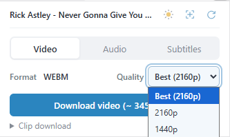
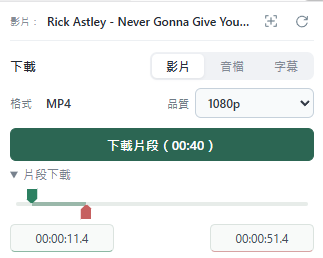

# VideoPocket - 網頁媒體下載與擷取 

**[下載 ZIP（約 2.3 MB）](https://github.com/g114056175/my_tools/releases/download/video-pocket-v1.0.0/VideoPocket.zip?sha=7fc1e1527ef4)** · 解壓約 7.1 MB · Chrome 120 以上

在網頁中選擇影片，下載影片、音檔或字幕；所有處理都在本機瀏覽器完成。

可將下載素材交給 LLM 整理，補足模型無法直接讀取影片連結的情況。工具不會自動上傳素材。

## 操作示範

<table>
<tr>
<td valign="top"></td>
<td valign="top"></td>
</tr>
</table>


<details>
<summary><strong>安裝方式</strong></summary>

1. 下載並解壓 ZIP。
2. 開啟 `chrome://extensions/`，啟用「開發人員模式」。
3. 點「載入未封裝項目」，選擇解壓後的 `VideoPocket` 資料夾。
4. 重新整理影片網頁，點工具列的 VideoPocket 圖示開始使用。

</details>

## 介面與功能

開啟工具後自動偵測影片；多部影片可用下拉選單切換，也可按選取按鈕指定網頁中的播放器。「↻」重新偵測，藍框標示目前選片。

### 影片

在 Video 選擇格式與畫質後下載。Best 顯示最高可用解析度；自動降級不會覆寫原本的畫質偏好。

展開 Clip download，拖曳起迄節點或輸入時間。若來源需完整下載後裁切，會顯示黃色提醒。

### 音檔

在 Audio 下載獨立音軌，或從影片抽取聲音，保留來源格式。

### 字幕

在 Subtitles 擷取、預覽、複製或儲存 TXT、SRT、VTT。YouTube 可嘗試自動切換所選字幕後還原；Bilibili 使用站方提供的字幕。

收起工具視窗後工作仍會繼續；工作列可查看進度、暫停、繼續或取消，實際能力依來源而定。

## 適用範圍與限制

**本專案僅供個人測試與技術研究使用。請勿違反串流媒體或其他網站的服務條款，並僅處理自己有權存取與保存的內容。使用者應自行確認相關授權與適用法規；本工具不提供繞過 DRM、付費或存取限制的功能。軟體依現況提供，不保證支援所有網站或持續可用；完整授權與免責條款請見 LICENSE。**

- 支援 YouTube、Bilibili、一般網頁影片與部分社群來源；可用性依播放資料、登入狀態與網站變動而定。
- 找不到來源時，可重新偵測或在網頁中選取播放器；多影片頁面也可進入單篇貼文操作。
- 「大小未知」不影響下載。大檔與裁切需預留磁碟空間，瀏覽器重開後不保留續傳能力；不支援直播錄製。

<details>
<summary><strong>開發細節、套件與參考</strong></summary>

### 架構與來源探索

- **Chrome Manifest V3**：popup 提供介面，service worker 管理工作，offscreen document 與 worker 執行下載及影音處理。
- **選片與解析**：讀取影片元素、Shadow DOM、播放器設定及播放中繼資料；以文件、播放器與媒體識別配對來源，避免混用廣告或其他影片。
- **播放器與檔案配對**：影片元素不一定直接包含檔案網址；動態換片、迷你視窗或廣告也可能重用元素。須核對文件、播放器及媒體身分，不能只靠畫面位置、順序或名稱配對。
- **通用探索**：借鑑 [yt-dlp Generic](https://github.com/yt-dlp/yt-dlp/blob/master/yt_dlp/extractor/generic.py) 的分層探索方式，辨識 JW Player、Video.js 與 JSON-LD，並核對來源是否屬於所選影片。
- **按需探索**：開啟工具或執行選片、字幕擷取、來源重驗時才觀察與解析；操作結束後停止並清除觀察紀錄。讀取現存播放器資料及瀏覽器資源紀錄有數量與時間上限。播放器已丟棄的一次性來源可能無法事後補抓，不保存播放緩衝或建立網域學習紀錄。
- **共同流程**：平台來源正規化後，共用畫質選擇、HLS／DASH 解析、傳輸、合併及儲存流程；YouTube／Bilibili 等特殊協定由各自模組處理。

### 影音、儲存與隱私

完整下載、影音合併及音軌抽取優先使用 stream copy，保留來源編碼。資料分段寫入 OPFS，限制預取數量，避免整部影片常駐記憶體；傳輸依持續無資料的時間判定逾時。

自管傳輸遵守伺服器等待時間；有強 ETag 時核對同檔範圍版本。下載來源拒絕存取時，可重新驗證同一選片與影音格式一次，再清除失敗資料重下；不自動更換影片或降畫質。

完成、取消或一般失敗後清理影音暫存；異常終止留下的孤立暫存，會在工具開啟且沒有活動工作時回收。成品由使用者管理，重名交由瀏覽器處理。

偏好保存在目前瀏覽器本機；字幕僅保留目前頁面最近一筆結果，重新整理、導覽或關閉分頁後失效。來源資料在工具開啟或下載期間保留，閒置約 60 秒後清理；關閉分頁即清除未使用的資料。不使用下載後端，不自動上傳素材或診斷，也不記錄 Cookie 值。簽名網址只在執行期間暫存；不永久保存或上傳簽名網址。

大小顯示使用已知位元組數，或能確認對應所選影音組合的全片平均位元率。音軌組合不明時顯示「大小未知」，片段不使用全片平均值換算大小。

### 區間擷取實作限制與未來考慮

HLS／DASH 依時間取得所需分段與解碼前置資料。一般 MP4 在具備可靠 sample table／SIDX 且來源支援 HTTP Range 時，可局部下載；否則在片長與格式可確認時，提供完整下載後裁切，並顯示提醒。

時間戳通常可由清單或索引取得，但切點影格可能依賴區間外的畫面。裁切須保留必要的解碼前置資料並對齊影音時間軸；切點合適時直接複製，相容的 H.264／MP4 或部分 VP9／WebM 可重編邊界並複製中段。輸出核對時間軸並解碼驗證；不適用或驗證失敗時，回退為整個所選區間的精準轉碼。

短片段、長 GOP、高解析度及瀏覽器編碼支援都可能增加處理成本。精度受原始影格與音訊封包間隔限制，局部下載不保證裁切處理比下載快。跨播放器的編碼參數切換與邊界相容性仍需持續驗證。

### 開發與驗證

```sh
npm ci
npm run release:check
```

`npm run release:check` 依序執行測試、重建觀察器、打包與校驗。產物為 `dist/VideoPocket.zip` 與可載入的 `dist/VideoPocket/`；校驗涵蓋來源引用、bundle、ZIP 內容與 SHA-256。測試涵蓋來源身分、標題、選片、畫質、字幕、傳輸與裁切；固定資料通過不代表所有網站的即時下載皆可用。測試範圍見 [驗證與測試](docs/release-regression.md)。

Mediabunny 的建置方式見 [evaluation/README.md](evaluation/README.md)，FFmpeg 對應來源與建置腳本見 [third-party/ffmpeg/](third-party/ffmpeg/)。

### 隨附開源元件

| 元件 | 用途 | 授權 |
| --- | --- | --- |
| [FFmpeg](https://ffmpeg.org/) 5.1.4 精簡 WebAssembly | 合併影音與抽取音軌 | LGPL-2.1-or-later；Emscripten runtime MIT |
| [Mediabunny](https://github.com/Vanilagy/mediabunny) 1.61.6 | 時間軸、封裝與 WebCodecs 裁切 | MPL-2.0 |
| [m3u8-parser](https://github.com/videojs/m3u8-parser) 7.2.0 | HLS 解析 | Apache-2.0 |
| [mpd-parser](https://github.com/videojs/mpd-parser) 1.4.0 | DASH 解析 | Apache-2.0 |
| [googlevideo](https://github.com/LuanRT/googlevideo/tree/01d5b091a6ce88ebf6d25a7b1b88914d9e16c294) | SABR／UMP 串流 | MIT |
| [protobuf-es](https://github.com/bufbuild/protobuf-es/tree/v2.6.2) 2.6.2 | Protocol Buffers 訊息 | Apache-2.0／BSD-3-Clause |

完整來源、修改及授權見 [第三方說明](extension/vendor/THIRD_PARTY.md)、[vendor/licenses/](extension/vendor/licenses/) 與 [licenses/](extension/licenses/)。專案程式使用 [MIT LICENSE](LICENSE)，第三方元件保留各自授權。

</details>
