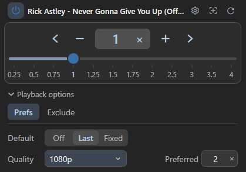

# VideoSpeed｜影片倍速控制 

**[下載 ZIP](https://github.com/g114056175/my_tools/releases/download/video-speed-v0.6.19/VideoSpeed.zip)** · Chrome／Brave · 預覽版

用滑桿、刻度與快捷鍵調整網頁影片倍速，依偏好設定下一部影片的起始速度。

<table>
<tr>
<td valign="top"></td>
<td valign="top"></td>
</tr>
</table>

<details>
<summary><strong>安裝方式</strong></summary>

1. 下載並解壓 ZIP。
2. 開啟 `chrome://extensions/`，啟用「開發人員模式」。Brave 使用 `brave://extensions/`。
3. 點「載入未封裝項目」，選擇包含 `manifest.json` 的 `VideoSpeed` 資料夾。
4. 開啟影片網頁即可使用快捷鍵；工具列圖示可開啟調速面板。

更新時以新版覆蓋原資料夾，再於擴充功能管理頁重新載入。

</details>

## 功能

- **直接調速**：輸入倍速、點選刻度或拖曳滑桿；左右加減按鈕依目前刻度區間微調。
- **自動選片**：依畫面內的影片大小、可見比例與位置選取主體；主片暫停仍可調速，捲動貼文時自動跟隨。手動選取僅短暫優先。
- **播放偏好**：速度可選關閉、跟隨上一部或指定倍速，動態載入與換片也適用。支援的播放器可設定起始畫質；首次套用後仍可手動調整。略過 YouTube、Bilibili 首頁與側欄的縮圖預覽，保留主影片控制。
- **自訂操作**：編輯刻度與快捷鍵；修改刻度不會立即改變正在播放的速度。
- **網站除外**：新增網域或影片網址，點規則旁的類型切換。`Full` 停止所有功能；`Default` 僅略過自動速度與畫質設定，保留手動操作。
- **背景節流**：切入頁面先掃描，停留時只處理變動；離開後最多補查 10 秒。已找到的待載入影片可等至離開後 30 秒，完成首次速度與畫質設定即停止背景控制；切回時恢復。更新不逐一接管閒置舊頁。
- **介面**：預設英文，可在齒輪設定切換中文及深淺色；設定自動保存。總開關可停用整體功能。

| 預設快捷鍵 | 操作 |
| --- | --- |
| `<`／`>` | 上一個／下一個刻度 |
| `:` | 還原 1× |
| `"` | 跳至偏好速度 |

快捷鍵可在齒輪設定中更改；細調快捷鍵預設不綁定。

## 適用範圍

適用於一般 HTML 影片與部分動態播放器。YouTube、Bilibili、Facebook、TikTok 已有部分實測，網站更新仍可能影響相容性。即時 MediaStream 不支援倍速；畫質設定依播放器提供的能力而定。

資料與偏好在瀏覽器本機處理，不使用下載後端，也不自動上傳影片、瀏覽資料或診斷。詳見 [隱私說明](docs/privacy-policy.md)。

問題請至 [Issues](https://github.com/g114056175/my_tools/issues) 回報，附上版本、網站與重現步驟。

<details>
<summary><strong>開發、驗證與授權</strong></summary>

Node.js 24：

```sh
npm ci
npm test
npm run build
npx playwright install chromium
npm run test:browser
npm run test:activity
npm run test:stability
npm run test:language
npm run test:popup
npm run test:autostart
npm run test:routes
npm run test:soak
npm run test:notices
npm run test:lifecycle
npm run test:loading
npm run test:network-loading
```

`src/` 為來源，`extension/` 為可直接載入的成品。瀏覽器測試使用隔離環境與本地固定資料；範圍及尚未驗證項目見 [驗證紀錄](docs/validation.md)。

使用 Python 3 執行 `python build/package.py` 可在 `dist/` 產生安裝 ZIP 與 SHA-256 檢查碼。Chrome Web Store 的簡要準備與文案見 [發布準備](docs/store-release.zh-TW.md)。

採用 [MIT License](LICENSE)。離線網域解析使用 [tldts](https://github.com/remusao/tldts)，第三方授權隨附於 [THIRD_PARTY_LICENSES.txt](extension/THIRD_PARTY_LICENSES.txt)。

</details>
